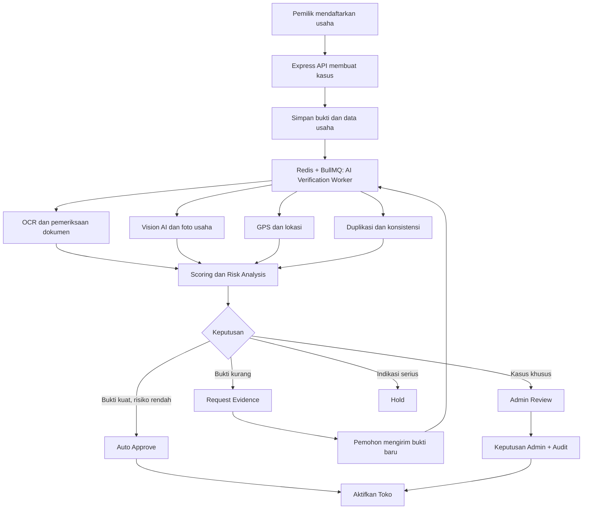

# Konsep Proyek sedek_aget — Marketplace Digital UMKM

Dokumen rangkuman konsep, arsitektur, fitur, proses bisnis, database, dan
sistem verifikasi usaha yang telah disepakati tim.

| Aspek            | Keterangan                                                        |
| ---------------- | ----------------------------------------------------------------- |
| Nama teknis      | `sedek_aget` (nama produk final menyusul)                          |
| Lomba            | Clean Code Web Programming — INFORMIND FEST VOL. II (HIMAIF UNIBI) |
| Subtema          | **EKRAF (Ekonomi Kreatif)** — digitalisasi UMKM lokal             |
| Status           | Konsep disepakati, siap masuk tahap perancangan teknis            |

---

## 1. Gambaran umum proyek

Kita akan membangun sebuah platform marketplace digital yang mengintegrasikan
berbagai UMKM lokal dalam satu ekosistem.

Platform ini bukan hanya tempat jual beli produk seperti marketplace pada
umumnya. Kita ingin membangun sistem yang membantu masyarakat menemukan,
mengenal, memesan, dan bertransaksi dengan UMKM yang berada di sekitar mereka.

Platform harus dapat digunakan oleh berbagai jenis usaha, mulai dari pedagang
kecil yang menggunakan gerobak, usaha rumahan, warung, toko, hingga penyedia
jasa.

Contohnya:

- Pedagang gorengan menggunakan gerobak.
- Penjual cilok dan jajanan keliling.
- Warung makan dan warung kelontong.
- Toko pakaian dan toko kebutuhan sehari-hari.
- Usaha kerajinan tangan.
- Bengkel motor.
- Jasa laundry.
- Jasa servis elektronik.
- Usaha katering.
- Penyedia jasa lainnya.

Visi utama: membantu UMKM lokal berkembang melalui teknologi digital tanpa
membatasi mereka berdasarkan ukuran usaha, kepemilikan merek, atau kelengkapan
dokumen formal yang tidak relevan.

## 2. Tujuan utama platform

1. Membantu UMKM kecil memasarkan produk dan jasa secara digital.
2. Memudahkan masyarakat menemukan usaha lokal di sekitar mereka.
3. Menyediakan sistem pemesanan produk sebelum pembeli datang ke toko.
4. Menyediakan sistem booking untuk usaha jasa.
5. Mengintegrasikan transaksi online dan pembayaran langsung di tempat.
6. Membantu pemilik UMKM mengelola toko, stok, pesanan, transaksi, dan laporan
   keuangan.
7. Menyediakan sistem verifikasi berbasis AI untuk menjaga kepercayaan
   pengguna.
8. Menyediakan data dan laporan yang membantu perkembangan UMKM.

## 3. Teknologi yang digunakan

Berikut teknologi yang sudah disepakati sebagai stack utama proyek.

### Frontend

- **React.js + Vite** — JavaScript dan JSX, tanpa TypeScript.
- **Bootstrap 5.3 + Custom CSS** — layout, komponen UI, responsive design.
- **Google Stitch** — perancangan UI/UX dan prototipe tampilan.
- **Bootstrap Icons + AOS** — ikon dan animasi saat halaman di-scroll.

### Backend

- **Node.js + Express.js** — REST API dan seluruh proses bisnis menggunakan
  JavaScript.

### Database dan pengelolaan data

- **MySQL 8.4** — database utama.
- **Prisma ORM** — penghubung backend dengan database.

### Background processing

- **Redis + BullMQ** — antrean pekerjaan AI, notifikasi, dan proses berat di
   belakang layar.

### Integrasi eksternal

- **Midtrans Snap** — pembayaran online.
- **Leaflet + OpenStreetMap** — peta dan lokasi UMKM.
- **Chart.js** — grafik dan laporan.
- **Docker + Nginx** — deployment dan server.

### Teknologi AI

- OCR untuk membaca dokumen dan teks pada bukti.
- Vision AI untuk menganalisis foto.
- LLM API untuk membantu analisis informasi.
- Image hashing dan perceptual hashing untuk mendeteksi duplikasi gambar.

### Aturan teknologi

Frontend React + JavaScript `.jsx`, backend Express + JavaScript `.js`.
**Tidak menggunakan** TypeScript, Next.js, Laravel, Blade, maupun
Tailwind CSS.

## 4. Konsep utama platform

Kita menggabungkan tiga sistem bisnis utama ke dalam satu platform.

### A. Marketplace produk

Pembeli dapat mencari produk, melihat harga, memilih jumlah, memasukkan
keranjang, melakukan checkout, dan membayar.

### B. Direktori dan peta UMKM lokal

Pengguna dapat mencari UMKM berdasarkan lokasi, jarak, kategori, dan jenis
usaha. Setiap usaha memiliki profil dan titik lokasi jika memiliki lokasi
tetap.

### C. Booking dan pre-order

Pembeli bisa memesan produk terlebih dahulu sebelum datang ke toko atau
melakukan booking layanan seperti laundry, servis motor, dan jasa lainnya.

Satu UMKM dapat menyediakan:

- Produk saja.
- Jasa saja.
- Produk sekaligus jasa.

Tidak perlu membuat platform berbeda untuk masing-masing jenis usaha.

## 5. Jenis pengguna dan hak akses

Kita menggunakan satu akun yang dapat memiliki beberapa kemampuan.

### A. Pengunjung

Pengunjung yang belum login dapat:

- Melihat halaman utama.
- Menjelajahi UMKM.
- Melihat katalog produk dan layanan.
- Melihat profil toko.
- Melihat lokasi usaha.
- Mencari produk dan jasa.

Namun, untuk checkout, pemesanan, booking, dan transaksi, pengguna harus login.

### B. Pembeli

Pembeli dapat:

- Mengelola profil.
- Menyimpan alamat.
- Mencari UMKM.
- Melakukan pembelian.
- Melakukan pre-order.
- Melakukan booking.
- Membayar secara online.
- Melihat riwayat transaksi.
- Memberikan ulasan.
- Menyimpan toko dan produk favorit.
- Melihat laporan belanja pribadi.

### C. Penjual

Penjual bukan jenis akun terpisah. Pengguna yang awalnya menjadi pembeli dapat
mengajukan diri sebagai penjual.

Alurnya:

1. Pengguna membuat akun.
2. Pengguna menggunakan marketplace sebagai pembeli.
3. Pengguna memilih menu "Daftarkan Usaha".
4. Mengisi data usaha dan mengirim bukti.
5. AI melakukan verifikasi.
6. Jika disetujui, pengguna memperoleh akses dashboard penjual.

Dengan begitu, satu akun bisa menjadi pembeli sekaligus penjual.

### D. Admin

Admin mengelola keseluruhan platform:

- Pengguna.
- Pengajuan UMKM.
- Verifikasi usaha.
- Kategori usaha.
- Toko.
- Produk dan layanan.
- Transaksi.
- Pembayaran.
- Booking.
- Laporan.
- Aktivitas dan keamanan.

### Konsep database peran

`users.role` cukup membedakan `admin` dan `customer`. Status penjual
ditentukan dari toko atau pengajuan usaha yang sudah disetujui, bukan dengan
mengubah akun menjadi role penjual yang menghilangkan kemampuan pembeli.

## 6. Sistem pendaftaran dan profil UMKM

Setiap UMKM memiliki profil toko yang dapat ditampilkan kepada masyarakat.

Informasi yang disediakan:

| Informasi       | Keterangan                                  |
| --------------- | ------------------------------------------- |
| Nama usaha      | Bebas, tidak harus berupa brand resmi       |
| Deskripsi       | Penjelasan tentang usaha                    |
| Kategori        | Makanan, pakaian, jasa, dan sebagainya      |
| Jenis usaha     | Produk, jasa, atau keduanya                 |
| Foto profil     | Logo atau foto usaha                        |
| Banner          | Foto tampilan toko                          |
| Alamat          | Alamat atau area operasional                |
| Lokasi          | Latitude dan longitude jika relevan        |
| Nomor telepon   | Kontak usaha                                |
| Jam operasional | Jadwal buka dan tutup                       |
| Foto usaha      | Bagian depan, dalam, produk, atau aktivitas |
| Produk          | Katalog barang                              |
| Layanan         | Katalog jasa                                |

Toko juga dapat memiliki banyak kategori melalui relasi many-to-many.

Untuk lokasi:

- Usaha tetap memiliki alamat dan pin peta.
- Usaha rumahan dapat memakai alamat rumah produksi.
- Usaha bergerak dapat menentukan area operasional.
- Foto tempat usaha menjadi bukti visual, bukan pengganti koordinat lokasi.

## 7. Sistem pemesanan dan transaksi

Kita memiliki tiga jenis alur transaksi.

### A. Pembelian produk langsung

Alur:

1. Pembeli memilih produk.
2. Menentukan jumlah.
3. Memasukkan produk ke keranjang.
4. Checkout.
5. Backend menghitung ulang harga.
6. Pembeli memilih pickup atau delivery.
7. Pembeli memilih metode pembayaran.
8. Transaksi diproses.
9. Penjual menerima pesanan.
10. Pesanan disiapkan atau dikirim.
11. Pesanan selesai setelah konfirmasi penyelesaian.

### B. Pre-order produk dan ambil di toko

Ini salah satu fitur pembeda utama platform kita.

Contoh: pembeli ingin membeli 20 gorengan, tetapi ingin mengambilnya satu jam
kemudian.

Alur:

1. Pembeli memilih toko.
2. Pembeli mengirim permintaan pesanan.
3. Penjual menerima permintaan.
4. Penjual memeriksa stok dan ketersediaan.
5. Penjual dapat menerima, menolak, atau menawarkan alternatif.
6. Penjual menentukan harga final dan waktu pengambilan.
7. Pembeli menyetujui pesanan.
8. Penjual menyiapkan pesanan.
9. Penjual menandai pesanan siap diambil.
10. Pembeli datang ke toko.
11. Pembeli membayar online atau langsung di toko sesuai kesepakatan.
12. Pesanan diselesaikan setelah pengambilan dikonfirmasi.

Pembeli juga bisa meminta produk khusus yang belum tercantum dalam katalog.
Contohnya:

> "Saya mau pesan 10 porsi nasi kuning untuk besok pagi."

Untuk permintaan khusus ini, kita tetap menggunakan sistem `seller_orders` dan
`order_items`, dengan `item_type = custom`. Tidak perlu membuat sistem
transaksi terpisah.

Aturan penting: pesanan tidak otomatis selesai hanya karena penjual menandai
pesanan siap diambil. Harus ada konfirmasi pengambilan atau penyelesaian.

### C. Booking layanan

Contoh: pelanggan ingin melakukan servis motor.

Alur:

1. Pembeli memilih layanan.
2. Memilih jadwal.
3. Mengirim permintaan booking.
4. Penjual memeriksa jadwal.
5. Penjual menerima atau menawarkan jadwal lain.
6. Harga disepakati.
7. Pembeli mengonfirmasi.
8. Pembayaran online dapat dilakukan setelah jadwal dan harga disepakati.
9. Layanan dikerjakan.
10. Transaksi diselesaikan.

Status booking harus dapat membedakan permintaan baru, diterima, menunggu
konfirmasi pembeli, terjadwal, selesai, dibatalkan, dan kedaluwarsa.

## 8. Sistem pengiriman dan pembayaran

### Metode pemenuhan pesanan

| Metode   | Keterangan                        |
| -------- | --------------------------------- |
| Pickup   | Pembeli datang mengambil pesanan  |
| Delivery | Pesanan dikirim ke alamat pembeli |

Untuk delivery, sistem dapat dikembangkan dengan informasi kurir, ongkir,
nomor resi, dan status pengiriman.

### Metode pembayaran

Kita merencanakan:

1. Pembayaran online menggunakan Midtrans Snap.
2. Pembayaran langsung di toko.
3. COD untuk pengiriman apabila nantinya diaktifkan dan diizinkan oleh
   penjual.

Untuk pembayaran langsung, penjual perlu melakukan konfirmasi pembayaran.

### Integrasi Midtrans

Alur teknis:

1. Pembeli melakukan checkout.
2. Backend Express menghitung total pembayaran.
3. Backend membuat transaksi dan meminta Snap Token ke Midtrans.
4. Frontend menampilkan halaman atau popup pembayaran.
5. Pembeli melakukan pembayaran.
6. Midtrans mengirim notifikasi ke backend melalui webhook.
7. Backend memverifikasi notifikasi dan tanda tangan.
8. Backend memperbarui status pembayaran.
9. Sistem memperbarui status pesanan sesuai hasil pembayaran.

Server Key Midtrans hanya disimpan di backend melalui `.env`.

Status pembayaran harus dipisahkan dari status pesanan.

Contoh status pembayaran:

- `pending`
- `paid`
- `failed`
- `expired`
- `refunded`

Catatan bisnis penting: sistem marketplace dengan banyak penjual tidak
otomatis mendapatkan fitur pembagian dana ke masing-masing penjual hanya
dengan akun Midtrans biasa. Kita perlu memastikan kemungkinan integrasi
melalui Midtrans Partner Solutions dan persyaratan onboarding-nya. Untuk MVP,
satu checkout hanya untuk satu toko.

## 9. Sistem pencarian dan peta UMKM

Peta UMKM menjadi fitur penting karena kita ingin membantu pembeli menemukan
usaha yang lokasinya dekat.

Fitur:

- Peta seluruh UMKM.
- Pencarian berdasarkan nama usaha.
- Filter berdasarkan kategori.
- Filter jarak.
- Lokasi pengguna.
- Detail toko dari marker peta.
- Navigasi menuju lokasi toko.
- Informasi jam operasional.
- Area operasional usaha bergerak.

Teknologi yang dipakai adalah Leaflet + OpenStreetMap.

Data lokasi disimpan dalam latitude dan longitude.

Kita tidak boleh menganggap lokasi foto otomatis sama dengan lokasi toko.
Koordinat dan informasi alamat harus diperiksa secara terpisah.

## 10. Sistem AI-Powered UMKM Verification

### A. Konsep verifikasi inklusif

Ini merupakan salah satu bagian paling penting dari proyek kita.

Kita tidak ingin platform hanya menerima usaha yang memiliki brand, toko
permanen, atau dokumen formal lengkap.

Prinsip utamanya: usaha kecil harus mendapatkan kesempatan yang sama untuk
bergabung.

Masalah yang ingin diselesaikan — banyak UMKM memiliki kondisi seperti:

- Belum memiliki NIB.
- Tidak memiliki merek dagang.
- Tidak memiliki surat kepemilikan tempat usaha.
- Menggunakan gerobak.
- Berjualan di depan rumah.
- Menyewa tempat.
- Berjualan di pasar.
- Berjualan secara keliling.
- Baru memulai usaha.

Jika sistem hanya memeriksa dokumen formal, usaha seperti ini akan sulit
bergabung. Karena itu, kita menggunakan pendekatan **Evidence-Based UMKM
Verification**, yaitu verifikasi berdasarkan bukti keberadaan dan aktivitas
usaha.

### B. Tiga kategori lokasi usaha

1. **Usaha tetap**

   Contoh: toko, bengkel, warung, kios.
   Bukti: foto bagian depan dan dalam, produk, alamat, GPS, dan kontak.

2. **Usaha rumahan**

   Contoh: katering rumahan, produksi keripik, penjual makanan dari rumah.
   Bukti: foto tempat produksi, produk, aktivitas usaha, alamat, dan kontak.

3. **Usaha bergerak**

   Contoh: pedagang keliling, jasa panggilan, penjual menggunakan motor.
   Bukti: foto peralatan, produk, aktivitas, kontak, dan wilayah operasional.

### C. Jenis bukti yang diterima

| Jenis bukti       | Contoh                                                     |
| ----------------- | ---------------------------------------------------------- |
| Identitas kontak  | OTP nomor HP atau email                                    |
| Bukti aktivitas   | Foto aktivitas usaha                                       |
| Bukti produk      | Foto produk yang dijual                                    |
| Bukti tempat      | Foto gerobak, kios, atau rumah produksi                    |
| Bukti lokasi      | GPS, alamat, atau area operasional                         |
| Bukti pengelolaan | Pernyataan sebagai pemilik atau pengelola                  |
| Bukti pendukung   | Nota bahan baku, surat keterangan pasar, referensi pemasok |
| Dokumen formal    | NIB, izin usaha, dokumen lain jika tersedia                |

Dokumen formal tidak diwajibkan secara universal. Bukti pendukung dapat
disesuaikan dengan jenis dan risiko usaha.

Kita juga harus membedakan:

- Pemilik usaha.
- Pengelola usaha.
- Orang yang mendapat kuasa untuk menjalankan usaha.

Pemohon tidak harus memiliki bangunan atau gerobak, tetapi harus memiliki
hubungan dan kewenangan yang sah terhadap usaha yang didaftarkan.

### D. Pemeriksaan oleh AI

AI akan menjalankan beberapa lapisan pemeriksaan.

| Lapisan | Pemeriksaan                                        |
| ------- | -------------------------------------------------- |
| A       | Identitas dan dokumen jika tersedia                |
| B       | Foto usaha, produk, dan aktivitas                  |
| C       | Lokasi, GPS, alamat, dan titik peta                |
| D       | Konsistensi nama, kategori, kontak, dan bukti      |
| E       | Duplikasi foto, dokumen, nomor telepon, dan lokasi  |
| F       | OTP email atau nomor telepon                       |
| G       | Penilaian skor dan risiko                          |
| H       | Rekomendasi keputusan verifikasi                   |

AI bukan hanya membaca apakah dokumen lengkap. AI harus menilai apakah bukti
yang diserahkan masuk akal untuk jenis usaha tersebut.

Contohnya, pedagang gorengan tidak harus memiliki foto interior toko atau
papan nama. Foto gerobak, produk, aktivitas berjualan, dan informasi lokasi
bisa lebih relevan.

### E. Dua jenis skor

Kita memisahkan:

- `verification_score`: tingkat kekuatan bukti bahwa usaha benar-benar ada
  dan dikelola pemohon.
- `risk_score`: tingkat indikasi masalah, ketidaksesuaian, atau penyalahgunaan.

Keduanya tidak boleh dicampur.

Contoh simulasi:

| Kondisi                               | Verification | Risk | Keputusan               |
| ------------------------------------- | ------------ | ---- | ----------------------- |
| Gerobak sederhana, bukti konsisten    | 92           | 8    | Layak disetujui         |
| Warung rumahan tanpa NIB, bukti cukup | 86           | 12   | Layak disetujui         |
| Foto sama dengan akun lain            | 85           | 75   | Pemeriksaan khusus      |
| Lokasi tidak cocok                    | 55           | 35   | Minta bukti tambahan    |
| Diduga memakai foto usaha orang lain  | 40           | 90   | Tahan untuk pemeriksaan |

Angka tersebut hanya ilustrasi, bukan batas produksi.

Indikasi serius tidak boleh tertutupi skor tinggi. Sebaliknya, tidak mempunyai
NIB atau brand bukan indikasi kecurangan.

### F. Keputusan verifikasi

Kita menggunakan persetujuan bersyarat (conditional approval).

Ada empat kemungkinan hasil:

1. **Auto-approve**: bukti memenuhi standar dan tidak ada indikasi risiko
   serius.
2. **Request more evidence**: AI membutuhkan bukti tambahan.
3. **Admin review**: ada kasus yang memerlukan penilaian manusia.
4. **Hold**: ditemukan indikasi serius yang harus diperiksa lebih lanjut.

Kasus yang belum jelas tidak langsung ditolak.

Admin berfungsi untuk menangani pengecualian, keberatan, audit, dan kasus
berisiko, bukan memeriksa seluruh pendaftaran satu per satu.

### G. Status verifikasi

Status proses AI:

`submitted`, `queued`, `processing`, `needs_documents`, `rechecking`,
`needs_review`, `approved`, `rejected`, `failed`.

Status toko dipisahkan:

`active`, `suspended`, `closed`.

Jika sistem mengalami gangguan teknis, statusnya `failed` atau perlu diproses
ulang. Gangguan teknis tidak boleh dianggap sebagai indikasi penipuan.

### H. Tingkatan status terverifikasi

Keputusan desain terbaru yang kita rekomendasikan adalah:

Semua UMKM yang lolos verifikasi mendapatkan status **Terverifikasi** yang
sama.

Tidak ada label publik yang membedakan usaha kecil dengan usaha besar atau
usaha yang memiliki dokumen formal dengan yang menggunakan bukti alternatif.

Kelengkapan dokumen dapat disimpan sebagai informasi internal untuk kebutuhan
audit, bukan sebagai label reputasi publik.

## 11. Alur teknis sistem AI

AI Verification berjalan secara asynchronous agar proses pemeriksaan tidak
membebani server API.



Tahapan implementasi:

1. Seller mengirim pengajuan.
2. Express membuat kasus verifikasi.
3. Bukti disimpan secara aman.
4. BullMQ menjalankan pekerjaan AI.
5. Setiap tahapan pemeriksaan disimpan.
6. Dashboard menampilkan progres.
7. Sistem meminta bukti tambahan jika perlu.
8. AI memberikan hasil dan rekomendasi.
9. Kasus khusus diteruskan kepada admin.
10. Toko aktif setelah keputusan disetujui.

Kita juga akan mengembangkan **AI Verification Center** pada dashboard admin
yang menampilkan:

- Jumlah pengajuan.
- Kasus yang sedang diproses.
- Kasus yang membutuhkan dokumen.
- Kasus yang membutuhkan admin.
- Foto dan dokumen.
- Hasil OCR dan Vision AI.
- Data lokasi.
- Verification Score dan Risk Score.
- Alasan keputusan.
- Riwayat pemeriksaan.
- Audit tindakan admin.

Penting: pada tahap awal, AI sebaiknya berjalan dalam **shadow mode**.
Artinya AI memberikan rekomendasi, tetapi hasilnya dibandingkan dengan
pemeriksaan manusia terlebih dahulu. Auto-approval baru diaktifkan setelah
tingkat ketepatannya terukur.

## 12. Struktur database utama

Database utama bernama `sedek_aget`.

Kita menggunakan MySQL 8.4 dengan Prisma ORM.

Berikut kelompok tabel yang direncanakan.

### A. Identitas dan pengelolaan UMKM

| Tabel                       | Fungsi                    |
| --------------------------- | ------------------------- |
| `users`                     | Data pengguna             |
| `seller_applications`       | Pengajuan menjadi penjual |
| `stores`                    | Data toko                 |
| `business_categories`       | Kategori usaha            |
| `store_business_categories` | Relasi toko dan kategori  |
| `store_locations`           | Alamat dan koordinat      |
| `store_photos`              | Foto usaha                |
| `store_operating_hours`     | Jam operasional           |

### B. Produk dan layanan

| Tabel                | Fungsi          |
| -------------------- | --------------- |
| `product_categories` | Kategori produk |
| `products`           | Data produk     |
| `product_images`     | Foto produk     |
| `service_categories` | Kategori jasa   |
| `services`           | Data layanan    |

### C. Keranjang, pesanan, dan transaksi

| Tabel                    | Fungsi                                 |
| ------------------------ | -------------------------------------- |
| `carts`                  | Keranjang pembeli                      |
| `cart_items`             | Produk dalam keranjang                 |
| `orders`                 | Pesanan utama                          |
| `seller_orders`          | Pesanan berdasarkan toko               |
| `order_items`            | Rincian barang pesanan                 |
| `payments`               | Data pembayaran                        |
| `payment_allocations`    | Persiapan pembagian dana di masa depan |
| `shipments`              | Informasi pengiriman                   |
| `order_status_histories` | Riwayat status pesanan                 |

Kita menggunakan `seller_orders` agar transaksi secara konseptual siap
dikembangkan menjadi marketplace multi-vendor. Namun MVP tetap membatasi satu
checkout untuk satu toko.

### D. Booking layanan

| Tabel                              | Fungsi                 |
| ---------------------------------- | ---------------------- |
| `service_bookings`                 | Data booking           |
| `service_booking_status_histories` | Riwayat status booking |

### E. Keuangan UMKM

| Tabel               | Fungsi                              |
| ------------------- | ----------------------------------- |
| `business_expenses` | Pengeluaran usaha                   |
| `business_incomes`  | Pemasukan usaha di luar marketplace |

Penjualan dari marketplace dihitung dari transaksi yang relevan, tidak dicatat
ulang sebagai pemasukan manual.

Untuk menghitung laba bersih secara benar, kita perlu mempertimbangkan HPP,
biaya operasional, biaya transaksi, pajak, dan refund.

### F. Aktivitas dan interaksi

| Tabel           | Fungsi                     |
| --------------- | -------------------------- |
| `activity_logs` | Riwayat aktivitas pengguna |
| `reviews`       | Ulasan dan rating          |
| `notifications` | Notifikasi                 |
| `favorites`     | Favorit toko atau produk   |

### G. AI Verification

| Tabel                         | Fungsi                            |
| ----------------------------- | --------------------------------- |
| `ai_verification_cases`       | Kasus verifikasi utama            |
| `ai_verification_steps`       | Tahapan pemeriksaan               |
| `ai_verification_results`     | Hasil setiap pemeriksaan          |
| `ai_verification_evidence`    | Bukti yang dikirim                |
| `ai_verification_flags`       | Temuan atau indikasi risiko       |
| `ai_verification_logs`        | Riwayat proses                    |
| `ai_verification_reviews`     | Tindakan admin                    |
| `ai_verification_settings`    | Konfigurasi dan aturan penilaian  |
| `business_evidence_types`     | Master jenis bukti                |
| `seller_application_evidence` | Relasi pengajuan dengan bukti     |
| `seller_declarations`         | Pernyataan pemilik atau pengelola |
| `business_location_types`     | Jenis lokasi usaha                |

Struktur ini masih merupakan rancangan konseptual. Detail kolom, tipe data,
indeks, foreign key, dan aturan relasi akan ditetapkan saat perancangan ERD
dan Prisma Schema.

## 13. Dashboard dan menu setiap pengguna

### A. Dashboard pembeli

| Menu                      | Fungsi                    |
| ------------------------- | ------------------------- |
| Dashboard                 | Ringkasan aktivitas       |
| Jelajahi UMKM             | Mencari toko              |
| Katalog Produk & Layanan  | Melihat produk dan jasa   |
| Peta UMKM                 | Melihat lokasi usaha      |
| Keranjang                 | Mengelola belanja         |
| Pesanan Saya              | Memantau pesanan          |
| Booking Saya              | Memantau booking          |
| Riwayat Transaksi         | Melihat pembayaran        |
| Laporan Belanja           | Rekap pengeluaran         |
| Produk yang Sering Dibeli | Riwayat produk favorit    |
| Favorit                   | Toko dan produk tersimpan |
| Aktivitas Saya            | Riwayat aktivitas         |
| Profil & Alamat           | Mengelola data diri       |

### B. Dashboard penjual

| Menu                 | Fungsi                    |
| -------------------- | ------------------------- |
| Dashboard Toko       | Ringkasan usaha           |
| Profil Toko & Lokasi | Mengelola informasi toko  |
| Manajemen Produk     | CRUD produk               |
| Manajemen Layanan    | CRUD layanan              |
| Manajemen Stok       | Mengelola persediaan      |
| Pesanan Masuk        | Mengelola pesanan         |
| Booking Masuk        | Mengelola jadwal          |
| Pengiriman           | Mengelola delivery        |
| Transaksi            | Riwayat transaksi         |
| Keuangan Toko        | Pemasukan dan pengeluaran |
| Laporan Penjualan    | Statistik penjualan       |
| Laporan Aktivitas    | Riwayat operasional       |

### C. Dashboard admin

| Menu                    | Fungsi                  |
| ----------------------- | ----------------------- |
| Dashboard               | Ringkasan platform      |
| Manajemen Pengguna      | Mengelola akun          |
| Verifikasi UMKM         | Mengelola pengajuan     |
| AI Verification Center  | Memantau pemeriksaan AI |
| Kategori Usaha          | Mengelola kategori      |
| Manajemen Toko & Lokasi | Mengelola toko          |
| Manajemen Produk/Jasa   | Monitoring katalog      |
| Manajemen Transaksi     | Monitoring pesanan      |
| Manajemen Booking       | Monitoring layanan      |
| Monitoring Pembayaran  | Memantau pembayaran     |
| Laporan Marketplace     | Statistik platform      |
| Aktivitas & Keamanan   | Audit aktivitas         |
| Pengaturan Sistem       | Konfigurasi platform    |

## 14. Sistem laporan dan analisis

Laporan tidak dibuat dengan menyimpan setiap jenis laporan ke tabel
tersendiri. Laporan akan dihitung dari data transaksi dan aktivitas yang sudah
tersedia.

Laporan pembeli:

- Total belanja per bulan.
- Total transaksi.
- Pengeluaran per toko.
- Produk yang paling sering dibeli.
- Riwayat booking.
- Status pembayaran.

Laporan penjual:

- Total penjualan.
- Produk terlaris.
- Pendapatan per bulan.
- Grafik tren penjualan.
- Stok produk.
- Produk hampir habis.
- Pesanan masuk.
- Booking layanan.
- Pengeluaran usaha.
- Pemasukan lain.
- Perkiraan laba dan rugi.

Laporan admin:

- Jumlah pengguna.
- Pertumbuhan UMKM.
- Jumlah toko aktif.
- Jumlah pengajuan verifikasi.
- Tingkat keberhasilan AI.
- Total transaksi.
- Total nilai transaksi.
- Aktivitas pengguna.
- Perkembangan kategori usaha.

Chart.js digunakan untuk visualisasi grafik dan statistik.

## 15. Struktur folder proyek

Kita menggunakan satu repository yang memisahkan frontend dan backend.

```
sedek_aget/
│
├── frontend/
│   ├── public/
│   ├── src/
│   │   ├── assets/
│   │   │   ├── images/
│   │   │   └── styles/
│   │   ├── components/
│   │   │   ├── common/
│   │   │   ├── navbar/
│   │   │   └── cards/
│   │   ├── layouts/
│   │   ├── pages/
│   │   │   ├── marketplace/
│   │   │   ├── buyer/
│   │   │   ├── seller/
│   │   │   └── admin/
│   │   ├── services/
│   │   ├── hooks/
│   │   ├── contexts/
│   │   ├── routes/
│   │   ├── App.jsx
│   │   └── main.jsx
│   └── package.json
│
├── backend/
│   ├── prisma/
│   │   └── schema.prisma
│   ├── src/
│   │   ├── config/
│   │   ├── middleware/
│   │   ├── modules/
│   │   │   ├── auth/
│   │   │   ├── users/
│   │   │   ├── stores/
│   │   │   ├── products/
│   │   │   ├── services/
│   │   │   ├── orders/
│   │   │   ├── bookings/
│   │   │   ├── payments/
│   │   │   ├── reports/
│   │   │   └── ai-verification/
│   │   ├── queues/
│   │   ├── jobs/
│   │   ├── utils/
│   │   ├── app.js
│   │   └── server.js
│   ├── .env
│   └── package.json
│
├── konteks/
│   ├── README.md
│   ├── konsep.md
│   ├── rules.md
│   └── STRUKTUR_CODE.md
│
├── .github/workflows/   # CI: lint + build check (syarat System Automated lomba)
│
├── docker-compose.yml
├── AGENTS.md
└── README.md
```

Struktur ini dapat berkembang seiring bertambahnya fitur tanpa harus
mencampurkan kode frontend dan backend.

## 16. Keamanan dan aturan bisnis penting

Beberapa aturan teknis dan bisnis perlu menjadi prinsip tetap:

1. Password pengguna harus di-hash.
2. Autentikasi menggunakan mekanisme session atau JWT dengan cookie
   `HttpOnly` yang aman.
3. Hak akses harus diperiksa di backend, bukan hanya menyembunyikan menu
   frontend.
4. Server Key Midtrans tidak boleh dikirim ke browser.
5. Webhook pembayaran harus diverifikasi dan idempotent.
6. Harga produk dihitung ulang oleh backend.
7. Stok harus diperbarui secara transaksional agar tidak minus.
8. Foto dan dokumen verifikasi disimpan di penyimpanan privat.
9. File bukti hanya dapat diakses pihak berwenang melalui akses terbatas.
10. Proses AI harus memiliki log dan audit.
11. Kegagalan layanan AI tidak otomatis berarti pengajuan penipuan.
12. Pengguna harus memiliki kesempatan melengkapi bukti dan mengajukan
    keberatan.
13. Data pribadi harus dikelola sesuai prinsip perlindungan data dan kebijakan
    retensi yang jelas.

## 17. Tahapan pengembangan proyek

Kita tidak langsung membangun semua fitur sekaligus. Kita bangun secara
bertahap agar setiap bagian dapat diuji sebelum melanjutkan.

1. **Tahap 1 — Perencanaan dan UI/UX (fondasi)**
   - Finalisasi kebutuhan sistem.
   - Desain halaman marketplace menggunakan Google Stitch.
   - Desain dashboard pembeli, penjual, dan admin.
   - Menentukan alur navigasi.
   - Menyusun ERD.
2. **Tahap 2 — Persiapan lingkungan**
   - Membuat proyek React + Vite.
   - Membuat backend Express.
   - Instalasi Bootstrap, Bootstrap Icons, AOS, dan React Router.
   - Konfigurasi MySQL dan Prisma.
   - Konfigurasi Git dan environment.
3. **Tahap 3 — Autentikasi dan pengguna**
   - Registrasi.
   - Login dan logout.
   - Profil pengguna.
   - Middleware autentikasi.
   - Hak akses admin dan customer.
4. **Tahap 4 — UMKM dan AI Verification**
   - Pendaftaran usaha.
   - Upload bukti usaha.
   - Profil toko.
   - Lokasi toko.
   - Proses pemeriksaan AI.
   - Dashboard verifikasi admin.
   - Aktivasi toko.
5. **Tahap 5 — Marketplace**
   - Kategori usaha.
   - Katalog produk.
   - Katalog jasa.
   - Pencarian.
   - Detail toko.
   - Peta UMKM.
   - Favorit.
6. **Tahap 6 — Pesanan dan booking**
   - Keranjang.
   - Checkout.
   - Pre-order.
   - Custom order.
   - Booking layanan.
   - Pickup dan delivery.
   - Riwayat pesanan.
7. **Tahap 7 — Pembayaran**
   - Integrasi Midtrans.
   - Snap Token.
   - Webhook.
   - Pembayaran langsung.
   - Monitoring pembayaran.
8. **Tahap 8 — Dashboard dan laporan**
   - Dashboard pembeli.
   - Dashboard penjual.
   - Dashboard admin.
   - Laporan penjualan.
   - Laporan keuangan.
   - Grafik Chart.js.
9. **Tahap 9 — Pengujian dan deployment**
   - Pengujian fungsional.
   - Pengujian keamanan.
   - Pengujian transaksi.
   - Pengujian verifikasi AI.
   - Docker.
   - Nginx.
   - Deployment server.

## 18. Keputusan konsep yang sudah disepakati

Bagian ini menjadi acuan agar pengembangan selanjutnya tidak berubah-ubah
tanpa alasan.

| Aspek                | Keputusan                                     |
| -------------------- | --------------------------------------------- |
| Bentuk platform      | Marketplace + direktori UMKM + booking        |
| Target usaha         | Semua skala UMKM, termasuk usaha mikro        |
| Brand                | Tidak wajib                                   |
| NIB                  | Tidak wajib untuk semua UMKM                  |
| Kepemilikan tempat   | Tidak wajib                                   |
| Verifikasi           | AI dengan persetujuan bersyarat               |
| Bukti usaha          | Fleksibel berdasarkan karakter usaha          |
| Lokasi               | Foto, GPS, alamat, dan pin sesuai jenis usaha |
| Admin                | Menangani pengecualian, audit, dan keberatan  |
| Status terverifikasi | Satu status publik untuk semua yang lolos     |
| Akun                 | Pembeli dan penjual dalam satu akun            |
| Penjual              | Harus mengajukan dan lolos verifikasi         |
| Katalog              | Produk, jasa, atau keduanya                   |
| Pemenuhan            | Pickup dan delivery                           |
| Pre-order            | Didukung                                      |
| Custom order         | Didukung                                      |
| Booking              | Didukung                                      |
| Pembayaran           | Midtrans dan pembayaran langsung             |
| MVP checkout         | Satu toko per checkout                        |
| Peta                 | Leaflet + OpenStreetMap                       |
| Frontend             | React + Vite + JavaScript                     |
| Backend              | Node.js + Express + JavaScript                |
| Database             | MySQL 8.4 + Prisma                            |
| Background job       | Redis + BullMQ                                |
| UI                   | Google Stitch, Bootstrap 5.3                  |
| Deployment           | Docker + Nginx                                |

## 19. Gambaran akhir ekosistem platform

**Ekosistem Digital UMKM — sedek_aget** adalah platform utama yang
menghubungkan masyarakat dengan UMKM lokal.

- **Pembeli** — belanja, pre-order, booking.
- **UMKM** — toko, produk, jasa.
- **Admin** — pengawasan dan audit.

Layanan inti: marketplace, peta UMKM, booking, pre-order, pembayaran,
laporan.

**AI-Powered UMKM Verification** memeriksa bukti usaha, foto, lokasi,
konsistensi data, dan indikasi risiko untuk menjaga kepercayaan ekosistem.

Infrastruktur teknologi: React, Express, MySQL, Prisma, Redis, BullMQ,
Midtrans, Docker.

## 20. Arah pengembangan selanjutnya

Fondasi konsep bisnis sudah cukup matang untuk mulai masuk ke tahap teknis.
Urutan yang perlu dijaga:

Pertama, **desain UI/UX**. Kita buat gambaran tampilan halaman utama
marketplace, halaman detail toko, halaman pendaftaran UMKM, dan dashboard
masing-masing pengguna menggunakan Google Stitch.

Kedua, **ERD dan database**. Kita pastikan hubungan antarentitas benar
sebelum menulis banyak kode. Ini penting karena sistem memiliki relasi cukup
kompleks antara pengguna, toko, produk, booking, pesanan, pembayaran, dan
verifikasi AI.

Ketiga, **implementasi secara bertahap**. Kita bangun dari autentikasi,
pengelolaan toko, verifikasi, hingga marketplace dan transaksi.

Kita juga mempertahankan prinsip pembelajaran dalam proses pengerjaan: setiap
fitur dijelaskan mulai dari konsep, fungsi, struktur folder, kode, penjelasan
baris penting, sampai cara mengujinya. Bukan sekadar memberikan kode jadi,
tetapi membantu memahami bagaimana seluruh platform bekerja.

Kesimpulan: kita sedang membangun bukan sekadar marketplace jual beli,
melainkan ekosistem digital yang membantu UMKM lokal ditemukan, dipercaya,
dikelola, dan dikembangkan — termasuk pedagang kecil yang baru memulai usaha
dari sebuah gerobak.

## 21. Batasan MVP untuk Lomba

Bagian ini melengkapi konsep agar selaras dengan *Guidebook Clean Code
INFORMIND FEST VOL. II*:

1. **Prioritas fitur inti.** Urutan pengerjaan: marketplace (katalog,
   keranjang, checkout), profil dan peta UMKM, pre-order, lalu verifikasi AI
   (pembeda inovasi). Fitur tambahan (COD, pembagian dana multi-vendor, dsb.)
   hanya dikerjakan setelah fitur inti stabil — penilaian lomba menimbang
   "keterjalanan fitur utama tanpa error/bug" (bobot Fungsionalitas 20%).
2. **System Automated wajib hijau.** CI/CD GitHub Actions (build check),
   ESLint, dan skor JSCPD < 50% adalah syarat seleksi Tahap 2. Setup CI
   ditambahkan sejak Tahap 2 (persiapan lingkungan), dan lint + build
   diperiksa di setiap tahap.
3. **Fallback demo.** Layanan eksternal (Midtrans Snap, API AI) wajib memiliki
   mode fallback/mock agar demo dan review tetap berjalan saat layanan
   eksternal gagal atau tidak tersedia.
4. **Naming konsisten.** Semua penamaan teknis memakai `sedek_aget` (repo,
   folder root, database) sampai nama produk final ditetapkan; perubahan nama
   dilakukan serentak saat ditetapkan.
5. **Dokumentasi wajib mutakhir.** README harus selalu memuat cara menjalankan
   proyek; rules.md memuat standar kode yang wajib dipatuhi seluruh
   kontributor.
